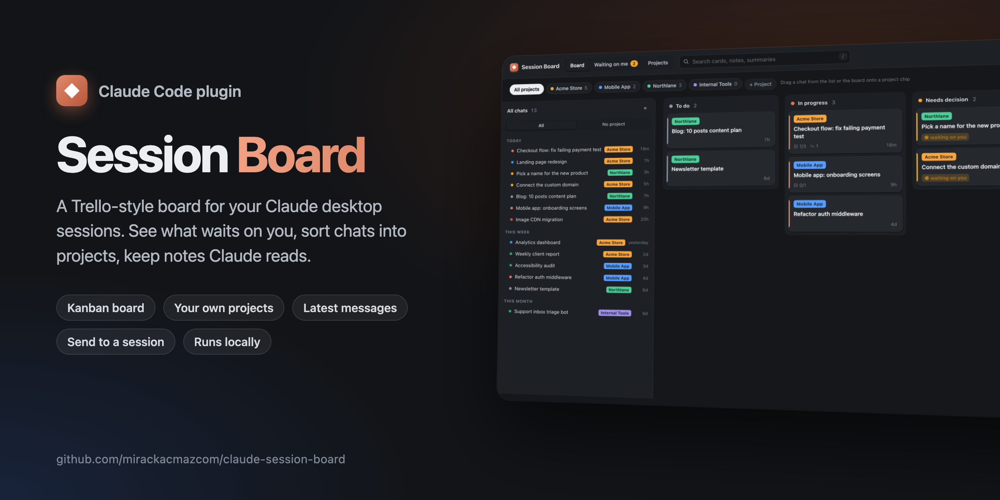
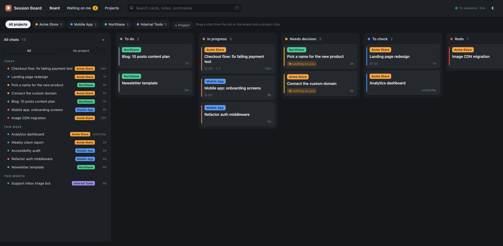
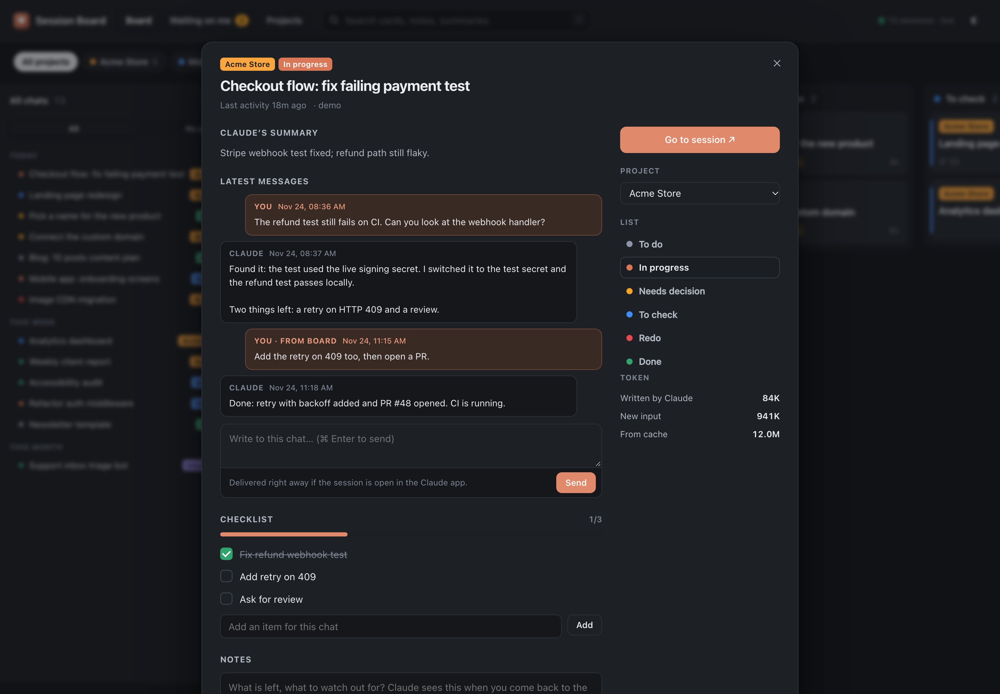
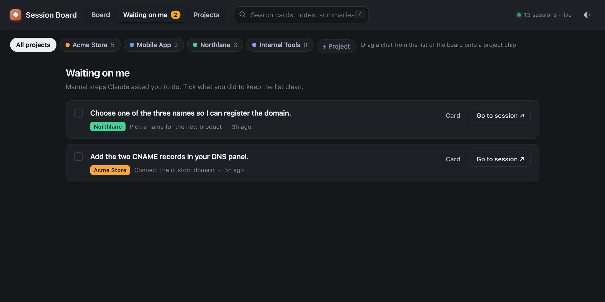
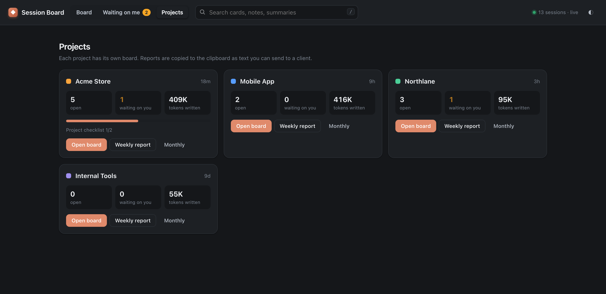
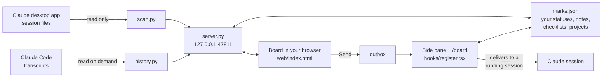

<p align="center">
  
</p>

<p align="center">
  <b>A Trello-style board for your Claude Code sessions in the Claude desktop app.</b><br>
  See what is waiting on you, sort chats into your own projects, keep notes Claude reads,<br>
  read the latest messages and send a message into any running session.
</p>

<p align="center">
  
  
  
  
  
</p>

---

## Why

When you run many Claude Code sessions at once, it is easy to lose track: which one is waiting
for a decision, which one you still need to check, what Claude asked you to do by hand, and where
you left off. Session Board puts every session on one board, next to the chat, without sending
anything off your computer.

## Features

| | |
|---|---|
| **Kanban board** | Columns *To do, In progress, Needs decision, To check, Redo, Done*. Drag cards between them. |
| **All chats list** | Every session grouped by *Today / This week / This month / Older*. Drag a chat onto a column or a project. |
| **Your own projects** | Create, rename, reorder and remove projects. Each has its own checklist and a weekly or monthly report you can copy and send. |
| **Waiting on me** | One list of the manual steps Claude asked you to do. Tick them off. |
| **Latest messages** | Each card shows the last 4 messages of the chat, read on demand and never stored. |
| **Send to a session** | Write into a running session straight from its card; Claude's reply shows up on the card. |
| **Notes Claude reads** | Status, notes and open checklist items are added to Claude's context in that session. |
| **Side pane** | `/board` opens a compact view next to the chat: what waits on you, what is next, one click to jump in. |
| **Tokens** | See how many tokens each session and project used. |

## Screenshots

**The board**: columns, project chips and the list of all chats.



**A card**: Claude's summary, the latest messages, a box to write into the session, checklist and notes.



<table>
<tr>
<td width="50%"><b>Waiting on me</b>: manual steps Claude asked you for.<br><br></td>
<td width="50%"><b>Projects</b>: open work, tokens and one-click reports.<br><br></td>
</tr>
</table>

<sub>Screenshots use made-up sample data.</sub>

## Install

**Requirements:** macOS, the Claude desktop app with Claude Code sessions, and `python3`
(it comes with Apple's Command Line Tools; run `xcode-select --install` if it is missing).

In the **Claude desktop app**: click **+** next to the prompt box → **Plugins** → **Add marketplace**
→ `mirackacmazcom/claude-session-board` → **Add plugin**.

At the prompt of a **Claude Code terminal session**:

```
/plugin install session-board --marketplace mirackacmazcom/claude-session-board
```

From a **shell**:

```bash
claude plugin install session-board --marketplace mirackacmazcom/claude-session-board
```

## Use

1. In any Claude Code session, type **`/board`**. The *Sessions* pane opens next to the chat.
2. Click **Open full board ↗** to open the board in your browser.
3. Click **+ Project** to create your first project, then drag chats from the left list onto it.
4. Drag cards between columns to set their status. Open a card to add notes and checklist items;
   Claude sees them the next time you work in that session.

## How it works



- **`hooks/register.tsx`**: the Claude Code mod. Side pane, `/board` command, the notes it adds to
  Claude's context, and delivery of messages sent from the board.
- **`scripts/server.py`**: a small web server (Python standard library only) that serves the board.
- **`scripts/scan.py`**: reads the desktop app's session list and per-session token totals.
- **`scripts/store.py`**: keeps your data in one JSON file, written under a lock so the pane and the
  board never overwrite each other.
- **`scripts/history.py`**: reads a session's latest messages when you open its card.
- **`scripts/outbox.py`**: queues messages you send from the board until a running session delivers them.

## Privacy

- Everything runs on your Mac. The plugin makes no network requests to anyone.
- It **reads** the Claude desktop app's session files
  (`~/Library/Application Support/Claude/claude-code-sessions`) and Claude Code transcripts
  (`~/.claude/projects`). It never changes them.
- Message text is read only when you open a card and is **never stored**.
- Your own data (statuses, notes, checklists, projects) lives in the plugin's data folder, in `marks.json`.

## Security

- The server listens on `127.0.0.1` only and checks the `Host` and `Origin` headers, so websites you
  visit cannot reach it.
- Every API call needs a random token kept in the plugin's data folder (file mode `0600`). The pane
  opens the board with the token in the URL fragment; the page then removes it from the address bar.
- *Go to session* and *Send* accept only session ids from the latest scan.
- It assumes a single-user Mac: while the board opens, the token is briefly visible in the process
  list to other accounts on the same computer.

## Limits

- **macOS only** for now.
- The desktop app's session files are not a documented format; an app update may hide some details
  until the plugin is updated.
- **Sending** works only for sessions that are running, and needs at least one *other* session running
  this plugin (a session cannot message itself). The message arrives as coming from another session,
  so Claude may ask you before doing anything destructive.
- Statuses you have not set are guessed from the session title and Claude's summary. Set one yourself
  to override the guess.

## FAQ

**Does it work with Claude Code in the terminal?**
The side pane and notes do. The board lists sessions from the Claude desktop app.

**Where is my data?**
In `~/.claude/plugins/data/session-board-claude-session-board/marks.json`. Delete the folder to start over.

**Can my team share one board?**
Not yet. The board is local to your Mac.

## Development

```bash
claude plugin validate .
claude plugin test .
```

Type-check with `tsc -p .` after Claude Code has loaded the plugin once: `tsconfig.json` extends the
type files the engine writes to `.claude-plugin/types/` (not part of this repository).

## License

[MIT](LICENSE)
